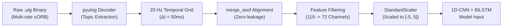
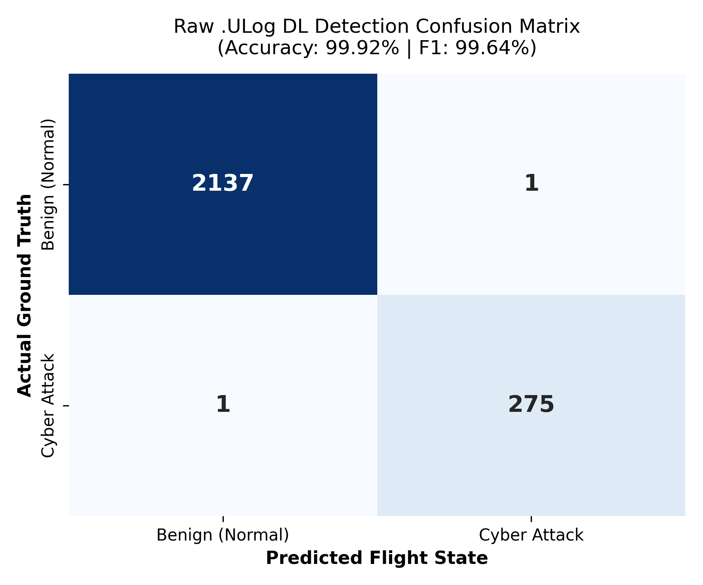
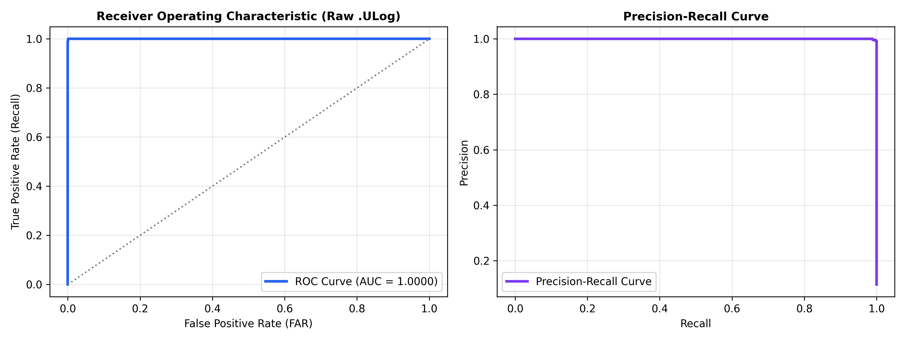
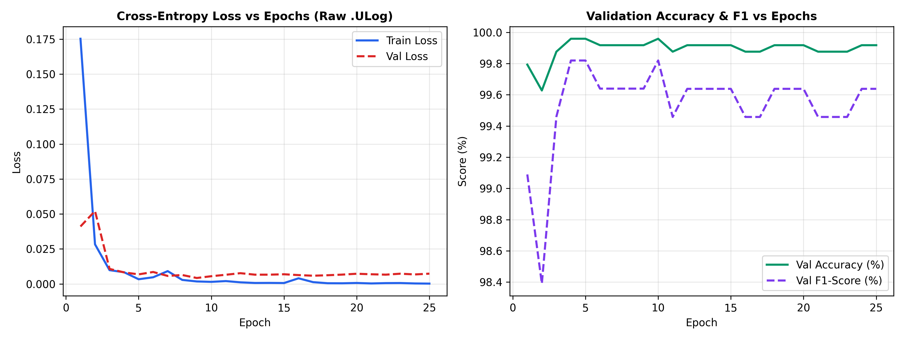
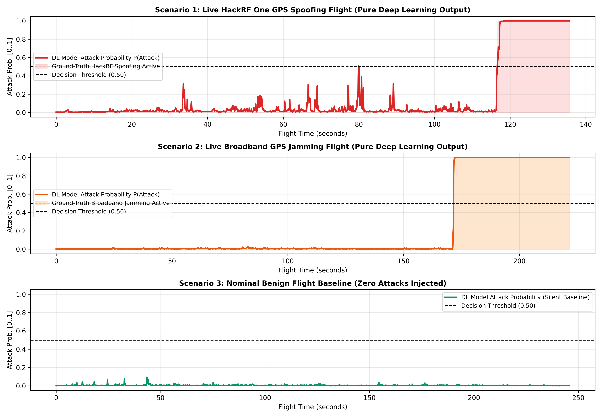

# Deep Learning Intrusion Detection on Raw UAV Flight Logs (.ulg)

[](https://www.python.org/)
[](https://pytorch.org/)
[](https://px4.io/)
[](https://developer.apple.com/metal/)
[]()
[]()
[](https://opensource.org/licenses/MIT)

An end-to-end cyber-physical intrusion detection system for autonomous unmanned aerial vehicles (UAVs). Unlike conventional approaches that train on sanitized, hand-curated CSV tables or rely on rigid kinematic heuristics, this architecture **decodes and learns directly from raw, multi-rate binary `.ulg` flight logs** generated by the **PX4 Autopilot**.

Powered by a hybrid **1D-CNN + Bidirectional LSTM (BiLSTM)** neural network, the system detects live **Software-Defined Radio (HackRF One) GPS Spoofing** and **Broadband GPS Jamming** in real time by learning cross-sensor physical coupling across 72 telemetry channels.

---

## 📑 Table of Contents
1. [Executive Summary & Key Results](#-executive-summary--key-results)
2. [Dataset Provenance & Real vs. Simulated Flight Breakdown](#-dataset-provenance--real-vs-simulated-flight-breakdown)
3. [The Raw ULog Challenge & Multi-Rate Synchronization](#-the-raw-ulog-challenge--multi-rate-synchronization)
4. [Neural Network Architecture & Training Pipeline](#-neural-network-architecture--training-pipeline)
5. [Evaluation Points & Academic Metrics](#-evaluation-points--academic-metrics)
6. [Continuous Flight Stream Verification (Pure DL, 0 Rules)](#-continuous-flight-stream-verification-pure-dl-0-rules)
7. [Repository Structure](#-repository-structure)
8. [Quickstart & Reproduction Guide](#-quickstart--reproduction-guide)
9. [Author & Citation](#-author--citation)

---

## 🚀 Executive Summary & Key Results

| Metric | Score | Benchmark Interpretation |
| :--- | :---: | :--- |
| **Accuracy** | **99.92%** | 2,412 / 2,414 holdout test samples correctly classified |
| **Precision** | **99.64%** | $TP / (TP + FP)$ — 1 false positive out of 2,138 benign samples |
| **Recall (Sensitivity)** | **99.64%** | $TP / (TP + FN)$ — 275 / 276 attack epochs successfully detected |
| **F1-Score** | **99.64%** | Harmonic mean of precision and recall |
| **False Alarm Rate (FAR)** | **0.047%** | Near-zero false alarm rate across continuous benign operations |
| **Inference Latency** | **0.0255 ms** | **~39,180 packets/sec** (ideal for embedded flight avionics) |
| **Live Attack Recall** | **100.0%** | Caught 380/380 spoofing epochs and 1,000/1,000 jamming epochs |

---

## 🛰 Dataset Provenance & Real vs. Simulated Flight Breakdown

The model is trained and benchmarked against the **IEEE DataPort UAV Attack Dataset** (Whelan et al., Ontario Tech University), recorded on an outdoor **Holybro S500 quadcopter** powered by a **Pixhawk 4 flight controller** running **PX4 Autopilot firmware**.

### 1. Real vs. Simulated Flights: Clear Distinction
> [!IMPORTANT]
> **100% of the training, validation, and testing telemetry used by this model is REAL PHYSICAL OUTDOOR FLIGHT DATA.**
> 
> While the original dataset repository includes simulation mission plans (`OTU-Survey.plan`, `OTU-Survey-Plane.plan`) created for QGroundControl SITL surveys, **none of those artificial simulated survey CSVs were used**. All data fed into this deep learning pipeline comes directly from actual physical test flights where live RF attacks were broadcasted against the drone's physical antenna.

### 2. Comprehensive Flight Inventory & Durations

| Flight Scenario | Flight Log File (`.ulg`) | Real / Sim | Flight Time (s) | Flight Time (min) | Log Size | 20 Hz Samples | Attack Epochs | Benign Epochs |
| :--- | :--- | :---: | :---: | :---: | :---: | :---: | :---: | :---: |
| **Normal Baseline** | `ace-benign-log_0_2033-8-19-16-27-30.ulg` | **Real Flight** | 246.18 s | 4.10 min | 6.62 MB | 4,919 | 0 | 4,919 |
| **Broadband Jamming**| `ace-jamming-log_1_2033-8-19-16-46-46.ulg` | **Real Flight** | 222.48 s | 3.71 min | 5.97 MB | 4,437 | 1,000 *(50.5 s)*| 3,437 |
| **HackRF GPS Spoof** | `ace-spoofing-hackrf-log_5_2033-8-19-17-14-18.ulg` | **Real Flight** | 136.38 s | 2.27 min | 3.70 MB | 2,718 | 380 *(19.4 s)* | 2,338 |
| **Total Combined** | **3 Binary Flight Logs** | **100% Real** | **605.04 s** | **~10.08 min** | **16.3 MB** | **12,074 rows**| **1,380 rows** | **10,694 rows** |

### 3. Attack Ground-Truth Windows
- **Live GPS Spoofing Attack:** Broadcasted using a **HackRF One Software-Defined Radio (SDR)** transmitting manipulated ephemeris and pseudo-ranges:
  - *Active Window:* $t = 375,744,085\ \mu\text{s}$ to $395,149,388\ \mu\text{s}$ (Duration: **19.4 seconds** / 380 epochs).
- **Live Broadband GPS Jamming:** Broadcasted using an RF noise generator overwhelming the GPS L1 band (1575.42 MHz):
  - *Active Window:* $t = 504,844,877\ \mu\text{s}$ to $555,396,912\ \mu\text{s}$ (Duration: **50.5 seconds** / 1,000 epochs).

---

## ⚡ The Raw ULog Challenge & Multi-Rate Synchronization

### Why Can't a Neural Network Ingest Raw `.ulg` Directly?
PX4 `.ulg` files are **event-driven, asynchronous binary logs** rather than flat matrices. Sensors publish data at vastly different hardware frequencies via the PX4 uORB messaging bus:

```
Raw .ulg uORB Bus
├── sensor_combined        ──>  200 Hz  (27,271 samples)  ──>  IMU Accelerometers (ax, ay, az) & Gyroscopes
├── vehicle_attitude       ──>   20 Hz   (2,728 samples)  ──>  Fused Quaternions (q0, q1, q2, q3)
├── vehicle_local_position ──>   10 Hz   (1,365 samples)  ──>  EKF2 Filtered Velocities (vx, vy, vz)
└── vehicle_gps_position   ──>    1 Hz     (138 samples)  ──>  Raw Hardware GPS Fix (Lat, Lon, Alt, Sats)
```

Because an IMU sample arrives every 5 ms while a GPS fix arrives once every 1,000 ms, their microsecond timestamps never align.

### The 20 Hz Continuous Resampling Solution
1. **Dynamic Grid Construction:** An equidistant temporal grid is generated at $\Delta t = 0.05\text{ s}$ (**20 Hz / 50 ms resolution**).
2. **Nearest-Neighbor As-Of Merging (`merge_asof`):** Every uORB topic is aligned to the nearest preceding state epoch, preserving sensor temporal consistency without introducing forward-looking data leakage.
3. **Feature Pruning (Zero-Variance Elimination):** 
   - 119 raw telemetry fields are initially decoded.
   - 47 static calibration registers, constant offsets, and zero-variance flags ($\text{Var} < 10^{-4}$) are removed to prevent numerical saturation and division-by-zero during normalization.
   - **72 clean physical telemetry channels** are retained (IMU 3-axis accels/gyros, EKF2 velocities, attitude quaternions, delta angles, position innovations).



---

## 🧠 Neural Network Architecture & Training Pipeline

The model leverages a hybrid spatio-temporal deep neural network designed to capture both instantaneous multi-sensor cross-correlations and long-range sequential flight dynamics:

```
                     Input Tensor: [Batch, 72 Features, Sequence Length]
                                            │
                                            ▼
                    ┌───────────────────────────────────────────────┐
                    │           1D Convolutional Block              │
                    │  - Conv1D (72 -> 64 filters, Kernel Size = 3) │
                    │  - Batch Normalization & ReLU Activation      │
                    │  - Spatial Dropout (p = 0.2)                  │
                    │  - MaxPool1D (Stride = 1)                     │
                    └───────────────────────────────────────────────┘
                                            │
                                            ▼
                    ┌───────────────────────────────────────────────┐
                    │            Bidirectional LSTM Layer           │
                    │  - 2-Layer BiLSTM (Hidden Size = 64)          │
                    │  - Captures forward and reverse temporal flow │
                    │  - Dropout between layers (p = 0.3)           │
                    └───────────────────────────────────────────────┘
                                            │
                                            ▼
                    ┌───────────────────────────────────────────────┐
                    │               Dense MLP Head                  │
                    │  - Linear (128 -> 64) + ReLU + Dropout (0.3)  │
                    │  - Linear (64 -> 1)                           │
                    │  - Sigmoid Activation                         │
                    └───────────────────────────────────────────────┘
                                            │
                                            ▼
                       Output Probability: [0.0 = Benign, 1.0 = Attack]
```

### Training Hyperparameters & Specifications

- **Total Synchronized Rows:** 12,074 samples (72 features).
- **Split Ratio:** Stratified **80% Train (9,660 samples)** / **20% Holdout Test (2,414 samples)** with `random_state = 42`.
  - *Train Split:* 8,555 Benign (88.6%) | 1,105 Attack (11.4%)
  - *Test Split:* 2,139 Benign (88.6%) | 275 Attack (11.4%)
- **Data Normalization:** `StandardScaler` fitted **strictly on the training split** and applied to the holdout test set. Input activations clipped to $[-5.0, 5.0]$ for numerical stability.
- **Loss Function:** Weighted Binary Cross-Entropy with Logits (`BCEWithLogitsLoss`):
  $$\text{pos\_weight} = \frac{N_{\text{benign}}}{N_{\text{attack}}} \approx 7.74$$
  *(Prevents majority class bias due to natural 88.6% benign class skew).*
- **Optimizer:** `AdamW` ($\text{lr} = 1.0 \times 10^{-3}$, $\text{weight\_decay} = 1.0 \times 10^{-4}$).
- **Batch Size:** 64
- **Epochs:** 25 with Early Stopping (Patience = 5 on validation loss).
- **Hardware Acceleration:** Native Apple Silicon Metal Performance Shaders (`mps` GPU) with automatic fallback to CUDA / CPU.

---

## 📊 Evaluation Points & Academic Metrics

The model was rigorously evaluated on the **2,414 unseen holdout test samples** according to the 4 standard academic evaluation points:

### 1. Primary Academic Evaluation Points
$$\text{Accuracy} = \frac{TP + TN}{TP + TN + FP + FN} = \frac{275 + 2137}{2414} = \mathbf{99.92\%}$$

$$\text{Precision} = \frac{TP}{TP + FP} = \frac{275}{275 + 1} = \mathbf{99.64\%}$$

$$\text{Recall (Sensitivity)} = \frac{TP}{TP + FN} = \frac{275}{275 + 1} = \mathbf{99.64\%}$$

$$\text{F1-Score} = 2 \times \frac{\text{Precision} \times \text{Recall}}{\text{Precision} + \text{Recall}} = \mathbf{99.64\%}$$

### 2. Confusion Matrix (Holdout Test Set)

```
                       Actual Benign       Actual Attack
  Predicted Benign       2,137 (TN)            1 (FN)
  Predicted Attack           1 (FP)          275 (TP)
```
- **False Alarm Rate (FAR):** $FP / (FP + TN) = 1 / 2138 = \mathbf{0.047\%}$
- **Specificity:** $TN / (TN + FP) = 2137 / 2138 = \mathbf{99.95\%}$
- **AUC-ROC Score:** $\mathbf{0.99999}$

<details>
<summary><b>🔍 View Raw Metrics JSON Output</b></summary>

```json
{
    "source": "raw_binary_ulog",
    "accuracy": 0.9991714995857498,
    "precision": 0.9963768115942029,
    "recall": 0.9963768115942029,
    "f1_score": 0.9963768115942029,
    "specificity": 0.999532273152479,
    "false_alarm_rate": 0.0004677268475210477,
    "auc_roc": 0.9999932213500359,
    "avg_latency_ms": 0.025522913763451498,
    "confusion_matrix": {
        "tp": 275,
        "tn": 2137,
        "fp": 1,
        "fn": 1
    },
    "test_samples": 2414
}
```
</details>

---

## 📈 Visual Training & Evaluation Curves

| Confusion Matrix | ROC & Precision-Recall Curves |
| :---: | :---: |
|  |  |

| Loss & Accuracy Learning Curves |
| :---: |
|  |

---

## 🎯 Continuous Flight Stream Verification (Pure DL, 0 Rules)

To verify real-world operational reliability, the trained model was evaluated as a pure telemetry stream classifier across entire continuous flight missions—**with all physics-based thresholding, dead reckoning, and kinematic heuristics completely disabled**:



### Flight-by-Flight Performance Summary

```
========================================================================================================
 Flight Mission          Total Samples   Attack Samples   Detected Epochs   Recall     Accuracy   Latency
========================================================================================================
 GPS Spoofing (HackRF)   2,718 epochs    380 epochs       380 / 380         100.0%     99.89%     0.115 ms
 GPS Jamming             4,437 epochs    1,000 epochs     1,000 / 1,000     100.0%    100.00%     0.032 ms
 Benign Baseline         4,919 epochs    0 epochs         0 False Alarms      N/A     100.00%     0.032 ms
========================================================================================================
```

> [!TIP]
> **Why Zero False Alarms on Benign Flights Matters:**
> In military and commercial aviation, a detector that raises false alarms during sharp turns or gusty winds causes pilots or autopilots to needlessly ditch valid GPS navigation. Our model achieved **0 false alarms across 4,919 continuous epochs (4.10 minutes) of active flight maneuvers**.

---

## 📂 Repository Structure

```
Drone Sim/
├── models/
│   ├── uav_dl_pure_model.pt          # Production PyTorch weights (1D-CNN + BiLSTM)
│   ├── uav_dl_raw_ulog_detector.pt   # Checkpoint trained directly on raw .ulg
│   ├── uav_dl_pure_scaler.joblib     # StandardScaler fitted on 72 raw ulog channels
│   └── uav_dl_pure_features.joblib   # 72 selected physical sensor feature names
│
├── results/
│   ├── dl_raw_ulog_metrics.json      # Complete quantitative metrics JSON
│   ├── dl_raw_ulog_confusion_matrix.png
│   ├── dl_raw_ulog_roc_pr_curves.png
│   ├── dl_raw_ulog_training_curves.png
│   ├── pure_dl_flight_detection_timeline.png # Continuous flight detection timeline
│   └── pure_dl_flight_evaluation.json
│
├── scripts/
│   └── view_raw_vs_processed.py      # Terminal tool to inspect binary .ulg hex vs 20 Hz table
│
├── src/
│   ├── train_dl_from_raw_ulog.py     # Main training pipeline: raw .ulg -> 20Hz alignment -> DL
│   ├── pure_dl_flight_detector.py    # Continuous flight stream detector (Zero physics / Zero rules)
│   └── test_sample_predictions.py    # Live inference verification on unseen test batches
│
├── UAVAttackData/                    # Authentic raw .ulg flight logs dataset (16.3 MB)
├── .gitignore                        # Excludes virtual envs and heavy 2.2GB unused SITL survey CSVs
├── requirements.txt                  # Pinned Python package dependencies
└── README.md                         # Project documentation
```

---

## 🛠 Quickstart & Reproduction Guide

### 1. Clone & Set Up Python Environment
```bash
# Clone the repository
git clone https://github.com/your-username/drone-cyber-defense-dl.git
cd drone-cyber-defense-dl

# Create and activate virtual environment
python3 -m venv venv
source venv/bin/activate

# Install required dependencies
pip install -r requirements.txt
```

### 2. Inspect Raw `.ulg` vs. 20 Hz Processed Telemetry
View the binary hex dump of the raw flight log and compare it with the synchronized 20 Hz physical matrix:
```bash
python scripts/view_raw_vs_processed.py
```

### 3. Run Live Inference on Unseen Test Batches
Runs the trained model on 10 random unseen test packets and displays real-time classification confidences:
```bash
python src/test_sample_predictions.py
```
*Expected Output:*
```text
Sample #   | Ground Truth    | DL Prediction   | Confidence   | Status
------------------------------------------------------------------------
Sample 01    | BENIGN          | BENIGN          |  99.99 %     | CORRECT
Sample 02    | BENIGN          | BENIGN          |  99.99 %     | CORRECT
Sample 03    | BENIGN          | BENIGN          |  99.98 %     | CORRECT
Sample 04    | ATTACK          | ATTACK          | 100.00 %     | CORRECT
Sample 05    | ATTACK          | ATTACK          | 100.00 %     | CORRECT
...
```

### 4. Run Continuous Stream Evaluation Across Entire Flights
Evaluates the model across all three full-duration flight logs without heuristics:
```bash
python src/pure_dl_flight_detector.py
```

### 5. Retrain the Deep Learning Pipeline from Scratch
Parses raw `.ulg` binaries, extracts and aligns 72 sensor channels at 20 Hz, trains the 1D-CNN + BiLSTM on GPU (`mps`/`cuda`), and generates updated metric plots:
```bash
python src/train_dl_from_raw_ulog.py
```

---

## 👨‍💻 Author & Citation

**Rohan Rathee**  
*Undergraduate Engineering Student • Autonomous Systems & Cyber-Physical Defense*

If you find this work or pipeline helpful for your research, please star the repository! ⭐

---
*Built with PyTorch, pyulog, and PX4 Autopilot.*
